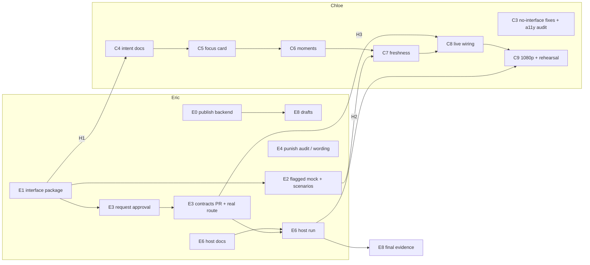

# Eric + Chloe: concurrent analytics implementation plan

Revised October 18, 2026 from [the analytics roadmap](ANALYTICS_ROADMAP.md) and the checkout at `c87dcbe` plus Eric's uncommitted working tree. This plan assigns tasks. It does not claim that new work is done, that any owner has agreed to it, or that it will finish by a particular time. It replaces the earlier version of this file. Old task IDs are mapped in the appendix.

## 1. Where things stand

The roadmap's first implementation task is already behind us. Plan from this baseline, not from the roadmap's DA1 starting point.

| Item | State | Evidence |
| --- | --- | --- |
| Chloe C1: read-only readiness checker | **Merged into `Eric`** (`914fc5e`, PR #19) | `analytics/integration_check.py`, 15 stub-server tests |
| Chloe C2: Stats/Learning correctness | **Merged into `Eric` and main** (`6e66871`, PRs #20/#21) | Throw denominator 1/4, first-fixed vs current habit, round-flush re-poll (2 s for up to 20 s), fine-tune hidden; `app/docs/acceptance/2026-10-18-stats-learning.md` |
| Eric DA1: counts and source evidence | **Implemented; included in the isolated review package** | `analytics/evidence.py`, `stats.opportunities`, [METRICS.md](METRICS.md) |
| Eric DA2: deterministic export | **Implemented; included in the isolated review package** | `analytics/insights.py`, internal `analytics/insights.schema.json`, [INSIGHTS_PROPOSAL.md](INSIGHTS_PROPOSAL.md) |
| Eric DA3 backend: focus and moments | **Implemented in the review package; action text still a draft** | `analytics/focus.py`, five-observation rule, manual override, punishment focus disabled |
| Report HTTP integration | Verified locally on synthetic and real copies | [IMPLEMENTATION_STATUS.md](IMPLEMENTATION_STATUS.md) |
| Public `/insights` route and mock route | **Implemented behind opt-in flags (D1, D2)**; app consumer waits for the interface agreement | `analytics/insights_v1.schema.json`, `fixtures/insights/public/`, [proposal](INSIGHTS_PROPOSAL.md) |
| Native Windows host run, brain decision trace (B5) | Layout confirmed (shared `C:\Users\sahil\la-hacks-2026\data`, no remote exec); waiting on Sahil's pasted source check and Sentry artifacts | [INTEGRATION.md](INTEGRATION.md), [brain evidence template](evidence/brain-decision-template.md) |

The subsequent [remediation verification](evidence/insights-host-verification.md) records 152 analytics cases (151 passed, one opt-in cloud skip), mocks 46/46 and actual HTTP source checks. It also supplies E1's generated examples, display rules and TypeScript sketch, and E6's launcher/source-proof commands. Native host inputs/run and interface/owner acceptance remain pending; the numbered work below remains the broader plan.

**What this means for the critical path.** Backend calculations are no longer the bottleneck. Three things are: publishing Eric's local work, agreeing the shared interface, and running on the Windows host. Chloe can work against fixtures for the whole time the agreement is pending.

## 2. Demo-ready core: scope

Release B from the roadmap, trimmed to what one screen pass can carry:

1. **One focus card** showing a label, a fraction, a state, one short action and "review N moments". The real fixture yields low defense at 0/16.
2. **Evidence for the focused metric**: up to three sampled source references plus `evidence_total`, and up to five important moments, each with round and frame.
3. **Truthful states**: `observed`, `early_signal`, `no_opportunities`, `invalid`, pending learning, report unavailable, and a synthetic label.
4. **Freshness**: "through round N", with a pending state while learning catches up, refreshed on the triggers C2 already built.
5. **Learning clarity**: rename option bars to "estimated effectiveness" with a note that untried options keep prior values. First-fixed vs current is already done in C2.
6. **Host evidence**: the checker, flush race, reconnect and session switching observed on Sahil's Windows machine, plus a deterministic demo export.

Out of the demo core: comparable-session history (DA6), the practice pilot (DA7), heatmaps, funnels, timing and retests (DA9), and an aligned bot-vs-player history chart. Section 9 lists these.

## 3. The shared interface package (deliver first)

This is the smallest package that lets Chloe build without waiting on Eric. Eric produces all of it. Chloe reviews it.

| Piece | File (Eric owns) | Content |
| --- | --- | --- |
| Public v1 subset | `analytics/INSIGHTS_PROPOSAL.md` (revise) | The response fields the app needs, listed below. Everything else stays internal to the export. |
| Field meanings and display rules | `analytics/handoffs/insights-ui.md` (new) | For each field and state: what it means, the recommended wording ("3 lows seen, need 5 to suggest a focus"), and what must never be shown (for example, a percentage when `value` is null). |
| Error and freshness semantics | Same two files | 404 unknown session, 422 bad id or query, 503 unstable or invalid source; `snapshot_id` changes iff sources change; `freshness.latest_recording_round` vs `latest_learning_round`; `pending_learning_rounds`; what "stale" means. |
| Realistic fixtures | `analytics/fixtures/insights/*.json` (new) | Generated by the real builder, never hand-edited: real M3 session; synthetic three-round set; plus edge cases for pending learning, early signal (1–4 opportunities), no opportunities, invalid (skipped lines or orphan break), manual focus, report unavailable, synthetic=true. A test regenerates them and fails on drift. |
| TypeScript sketch | Appendix of INSIGHTS_PROPOSAL.md | A type Chloe can paste into `app/src/renderer/src/services/contracts.ts`. Eric does not edit app files. |

**Proposed public v1 subset** (decision D2). Keep: `format_version`, `snapshot_id`, `session_id`, `synthetic`, `freshness`, `quality.state`, `metrics.{low_defense,throw_defense,punish_conversion}` (label, successes, opportunities, failures, value, state, estimated, evidence ≤3, evidence_total), `focus`, `learning.habits` (first-fixed and current), `moments` (≤ `limit`, default 5), `moments_total`, `report.status`. Keep internal: source hashes and byte counts, `tactical`, `bandit_estimates`, per-round blocks, invalid line positions. A smaller surface is quicker to agree and less for Chloe to render. Internal fields can be promoted later through the same process.

### What needs four-owner agreement under the frozen-contract rule

| Change | Needs agreement? | Notes |
| --- | --- | --- |
| New `GET /insights/{session_id}` row in `contracts/api.md`, plus `contracts/insights.schema.json` and an example | **Yes** | Eric drafts one contracts PR and is its only editor. Sahil, Garrett and Chloe review. |
| Any field added to `/stats`, `/learning`, `/trends` or `metrics.schema.json` | **Yes**: avoid | Not needed for the demo core. |
| Producer extensions: predictor correct/total, live target, trial and retest records, config ids | **Yes**: Sahil proposes | Later. Not on the demo path. |
| History route (DA6) | **Yes** | Later. |
| Internal export CLI, internal schema, fixtures, UI-states doc | No | Eric's folder; already allowed. |
| Opt-in experimental mock route (D1) | No contract change; disclose it | Mock stays faithful to the frozen contract by default. |
| App code that reads fixtures or the flagged mock, off by default | No | Chloe's folder. It ships to users only after agreement. |
| Changing version-4 stored calculations | No, but Eric-only | Requires a version bump and a scoped backfill. Not planned. |

Do not read a shared sidecar file from the app as a way around agreement.

## 4. Who owns each shared file

| Artifact | Single owner | Others |
| --- | --- | --- |
| `contracts/*` (insight additions) | Eric drafts, after four approvals | Review only |
| `analytics/*` code, tests, docs, fixtures, `insights.schema.json` | Eric | Chloe files issues with a failing command, the expected and actual response, and the session id |
| `analytics/integration_check.py` and its test | **Proposed: Eric maintains from now on** (Chloe confirms) | Chloe wrote it; this frees her for app work |
| `tools/mock/*` | Eric | — |
| `tools/status/checks.json`, `tools/status/requests/*` | Eric | Others ask Eric to add requests |
| `app/**`, including `services/contracts.ts`, `services/analytics.ts`, intent and spec docs, acceptance notes | Chloe | Eric never edits these |
| Focus action wording | Text lives in `analytics/focus.py` (Eric) | Garrett approves the wording; Chloe renders it verbatim and never rewrites mechanics in TypeScript |
| Display wording for states and labels | Proposed in `insights-ui.md` (Eric) | Chloe owns the final UI text in `app/` |
| Root `README.md`, Devpost and sponsor text | Eric drafts under `analytics/submission/` | Owner review before publishing |
| `data/samples/*` | Nobody edits during this plan | Fixtures live in `analytics/fixtures/` |

Work on separate branches (`Eric`, `chloe`). Stage explicit paths only. Run `python3 tools/status/status.py` before each merge.

## 5. Eric's lane (about 75–80% of the work)

| ID | Task | Deliverable and acceptance | Can start | Depends on |
| --- | --- | --- | --- | --- |
| **E0** | Publish the local first-release backend | Split into reviewable PRs (metrics and evidence; export and focus; docs and submission drafts) through `/handoff`. Fix the stale C1 status in IMPLEMENTATION_STATUS.md. Full analytics and mock suites, `contracts/validate.py` and both smokes pass on the PR commit. Calculation version stays 4. | **Now** | — |
| **E1** ✅ | Interface package (section 3) | v1 subset in INSIGHTS_PROPOSAL.md, `insights-ui.md`, generated fixtures with a drift test, TS sketch. Done when Chloe can name every UI state from the fixtures without asking. **Handoff H1 → Chloe.** | **Now**, in parallel with E0 | — |
| **E2** ✅ | Experimental mock route and scenario player (D1) | `tools/mock/serve.py --experimental-insights` serves `GET /insights/{id}` from the same builder. A scenario mode advances rounds, delays the learning flush, sends duplicate summaries, drops and reconnects the socket, and switches sessions. Default mock behavior is unchanged; existing mock tests pass. **Handoff H2 → Chloe.** | **Now**, once D1 is accepted | E1 subset |
| **E3** | Agreement, contracts PR and real route | Ask all four owners to approve. Draft the contracts PR (api.md row, schema, example). Add the real route in `analytics/main.py` using the same builder. Tests: 404/422/503, real = mock = export parity, existing routes unchanged, `validate.py` passes. Measure HTTP p95 on the real fixture locally (target under 250 ms). **Handoff H3 → Chloe.** | Ask now; build after approval | Four approvals |
| **E4** | Focus wording and punishment audit | Send Garrett the draft action text for low and throw defense. Review all six real-fixture punish opportunities and record whether each pairing is mechanically sensible. Enable punishment focus only if Garrett agrees; otherwise keep it as an "estimated" count only. | Audit **now**; wording waits on Garrett | Garrett |
| **E5** | Readiness checker for insights | If D4 is accepted: add an optional `--insights` check (identity, snapshot changes on round advance, learning pending → current) with stub tests. | After E3 | E3 |
| **E6** | Host integration | Native PowerShell commands and one authoritative `DATA_DIR` in INTEGRATION.md. With Sahil: run the checker in snapshot and advance-required modes on a growing session; observe the flush race, reconnect, session switching and Ctrl-C; measure p95 and the time from summary to visible update (target 2 s once files are present). Record the results; do not estimate them. | Docs **now**; run needs host | Sahil, host, C-lane build |
| **E7** | Close out B5 Sentry | Verify Sahil's decision trace, waterfall and on/off timings against the template. Keep the sponsor gate separate from player readiness. | When Sahil delivers | Sahil |
| **E8** | Demo evidence and claims | Regenerate the export from the host session and the real fixture. Trace every number in the Devpost and sponsor drafts to a command or trace. Label any synthetic data. Tell only the detection/exploitation story unless a real improvement recording exists. | Drafts **now**; final after E6 | E6 |

Supporting work Eric does so Chloe has less to do (without editing her code): E1 fixtures and wording guide; E2 scenario player (so she can test freshness without the game); the TS type sketch; E5 checker coverage; a one-page 1080p acceptance checklist in `insights-ui.md` (states to screenshot, minimum text sizes, keyboard path); and triage of any data defect she finds.

## 6. Chloe's lane (bounded app work under `app/AGENTS.md`)

Every task follows her linked-intent workflow (HLD check → LLD → EARS → code), owner review, `npm run typecheck` and `npm run build`. No new automated tests.

| ID | Task | Deliverable and acceptance | Can start | Depends on |
| --- | --- | --- | --- | --- |
| **C3** | Changes that need no interface | Option bars become "estimated effectiveness", with the untried-prior note. Accessibility audit of the existing Stats and Learning screens: contrast, keyboard order, labels, and color never the only success/failure signal. Specs updated. | **Now** | — |
| **C4** | Intent docs for insights | LLD and EARS updates for the focus card, evidence list, moments and states, written against H1. Suggested placement, which is Chloe's call: focus card at the top of Stats, evidence and moments beneath it. Return any unclear field to Eric within this task. | After **H1** | E1 |
| **C5** | Focus card and metric evidence | Renders `focus` and the focused metric's fraction, state, action (verbatim) and evidence, from a fixture or the flagged mock. Every fixture state renders correctly; null `value` never shows as 0%. The insights source stays **off by default**. | After H1 (fixtures), or H2 (mock) | E1/E2 |
| **C6** | Moments and selection | A list of up to five moments with round, frame, outcome and response. Selecting one shows the event in place. "Report unavailable" falls back to event-only. Synthetic sets show a label. | After C5 | E1 |
| **C7** | Insights freshness | Refetch insights on the triggers C2 already uses. Show "through round N" and pending learning. If `snapshot_id` changes, clear a selected moment that is no longer valid. Bind results to the selected session. Checked with the E2 scenario player: pending → current, duplicates do not double-count, reconnect converges, a session switch never shows another set's numbers. | After H2 | E2 |
| **C8** | Live wiring | Point the insights source at the real route and turn it on by default. This should be a small change in `services/analytics.ts`. | After **H3** | E3 |
| **C9** | 1080p and accessibility pass, host rehearsal | Screenshots of each state at the video resolution, using Eric's checklist. Voice wording and timing rehearsed on the host (already pending from C2). Acceptance note in `app/docs/acceptance/`. | After C5–C7; host for rehearsal | E6 |

If Chloe runs out of capacity, stop after C5 with the source turned off. The demo still has the C2 screens plus Eric's export (fallback F1).

## 7. Dependencies on Sahil and Garrett, and fallbacks

| Needed from | What | Blocks | Fallback that keeps work moving |
| --- | --- | --- | --- |
| All four | Approve the v1 insight contract | E3 → C8 | F1: demo uses the C2 screens plus the deterministic Markdown/JSON export; C5–C7 stay off by default |
| Garrett | Approve the action wording | Showing focus action text | Card shows the fraction plus a neutral "Review these moments" template; no mechanical advice |
| Garrett | Agree with the punishment audit | Punishment as a focus candidate | Keep it as an "estimated" count, excluded from focus (current behavior) |
| Garrett | Report service on the host | Report-backed moment detail | Event-only moment detail (already the design) |
| Sahil | Windows host session and process layout | E6, C9 rehearsal, release B sign-off | Rehearse locally with the real fixture and the E2 scenario player, clearly labelled as not a host run |
| Sahil | Brain decision trace and timings | E7, Sentry sponsor claim | Submit only the analytics and replay Sentry evidence that is already retained |
| Sahil | Predictor correct/total counts, live target | Count detail on accuracy; live focus target | Show recorded percentages with "count unavailable"; target = last completed round |
| Sahil | A new improvement or retention recording | A player-improvement story | Detection/exploitation story only |

## 8. Parallel lanes, critical path and checkpoints



**Start immediately, with no waiting either way:** Eric E0, E1, E4 audit, E6 docs, E8 drafts. Chloe C3.

**Critical path:** E1 → four-owner approval → E3 real route → C8 live wiring → E6 host run → E8 final evidence. Approval is the longest unknown, so Eric asks for it as soon as E1's subset is written, not after E0 merges.

**Checkpoints:**

| Checkpoint | Earliest trigger | Pass condition |
| --- | --- | --- |
| **IC1: fixture integration** (earliest) | H1 + C5 | Chloe's focus card renders every fixture state on her Mac; Eric confirms the numbers match the export (0/16, 1/4, 0/6 estimated, low-defense focus, after-block first fixed in round 2 and regressed in round 3, null fine-tune) |
| **IC2: live local** | H2 + C7, then H3 + C8 | The app against the flagged mock passes the scenario checks; after H3, the same checks pass against real analytics with `DATA_DIR=./data/samples/live_learning` |
| **IC3: host** | E6 + C8 | Advance-required checker exits 0 on a growing Windows session; flush race, reconnect and session switching observed; timings recorded |

## 9. Later enhancements (not in the demo core)

| Item | Owner split | Gate |
| --- | --- | --- |
| DA6 comparable-session history (`analytics/history.py`, pooled counts, history route) | Eric builds; Chloe adds a history view later | Demo core shipped; history route agreed; enough comparable sessions |
| DA7 practice/retention/transfer pilot | Eric designs with Sahil; Chloe reviews readability | Agreed collection and cloud scope; frozen bot configuration |
| Aligned bot-accuracy vs player-defense chart | Eric adds per-round blocks to the public subset; Chloe charts them | Promote `rounds` through the contract process |
| DA9 heatmap, punish funnel, timing, retests, trial counts | Eric analyzes; Sahil supplies producer signals; Garrett checks mechanics | Producer semantics exist and a user need is shown |
| Fine-tune before/after display | Sahil produces; Eric validates; Chloe shows it only when numeric | A real held-out evaluation file |

## 10. Decisions that change scope or parallelism

| # | Decision | Recommended default | Why it matters |
| --- | --- | --- | --- |
| D1 | Allow an opt-in experimental `/insights` route in the mock before agreement | **Accepted.** Off by default, same builder, disclosed in the proposal; the app's insights source stays off until H3 | Without it, Chloe either waits for agreement or copies fixture JSON into `app/` |
| D2 | Propose the minimal v1 subset rather than the full internal schema | **Accepted** (section 3 list; v1 also carries `recording_sha256`, evidence events and per-metric moment outcomes) | Quicker four-way agreement and less rendering work for Chloe |
| D3 | Demo deadline, and when to fall back if approval hasn't arrived | **Unknown deadline. Default: if four approvals are not in by the time IC1 passes, plan the demo on F1 and keep C5–C7 off by default** | Determines whether Chloe's time goes to C5–C7 or to polishing existing screens |
| D4 | Eric takes over maintaining `integration_check.py` | **Yes**, with Chloe's OK | Removes a second analytics surface from Chloe's lane |

## 11. Commands

These exist today:

```sh
.venv/bin/python -m analytics.insights 2026-10-18T05-14-03_sahil_djin_vs_kaz --data-dir ./data/samples/live_learning --output-dir ./data/analytics
SENTRY_DSN= DATABASE_URL= .venv/bin/python -m unittest discover -s analytics/tests -v
.venv/bin/python -m unittest discover -s tools/mock/tests -v
.venv/bin/python contracts/validate.py
.venv/bin/python -m analytics.integration_check --session-id 2026-10-18T05-14-03_sahil_djin_vs_kaz
```

The export shows 0/16 lows, 1/4 throws, 0/6 estimated punishes, low-defense focus and null evaluation. The checker exits 0 in snapshot mode against real analytics plus mock brain and replay on the real sample, and exits 2 with `--require-advance` on that static sample. `serve.py --experimental-insights`, `serve.py --live-dir` and `GET /insights/{id}` (with `KUMITE_EXPERIMENTAL_INSIGHTS=1`) now exist behind flags; `integration_check --insights` waits for E5. Chloe's checks remain `npm run typecheck` and `npm run build` from `app/`.

## Appendix: old task IDs

The previous version of this plan used E1–E5 and C1–C3. Old E1, E2 and the backend half of E3 are now implemented locally and are published by new E0. Old E3's API/mock half is new E2/E3. Old E4 is new E6/E7. Old E5 is new E8. Old C1/C2 are merged. Old C3 is split into new C4–C8.
