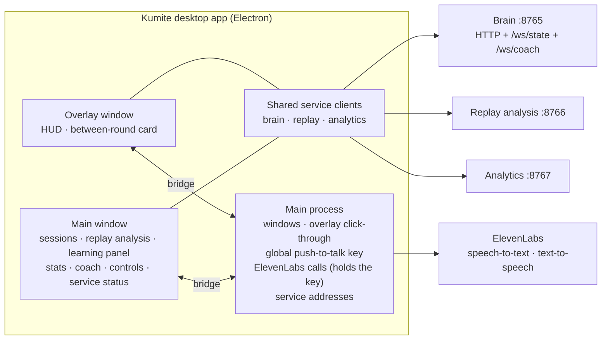

# High-Level Design: Kumite Desktop App

## Problem

Kumite's bot learns a player's habits, exploits them, and its services explain what happened, but all of that lives in three local HTTP services and JSONL files. A player in the middle of a set has no way to see what the bot is watching or hear the coach between rounds without leaving the game, and after the set has no single place to read the report, see whether the bot actually learned, and ask follow-up questions. The hackathon judges have the same gap: the Model Learning track asks for proof that the system learns, in numbers, and that proof has to be visible on a 1080p demo video and at a loud booth.

## Approach

One Electron desktop app with two windows that share one design system.

- **Overlay window.** A transparent, always-on-top, click-through window drawn over Tekken 8 (borderless windowed). It shows a corner HUD during play and a between-round card with the coach's spoken tip.
- **Main window.** The place for everything before and after a set: sessions, replay analysis, the learning panel, stats, the coach conversation by text or voice, and the bot's controls.

The app is a view over other tracks' services. It renders what the brain (:8765), replay analysis (:8766) and analytics (:8767) services return, in the shapes fixed by `contracts/`, and adds voice through ElevenLabs. It never touches the game.

## Target Users

- **The player in a set** (beginner-to-intermediate Tekken player): eyes on the game, hands on a stick or pad. Needs a glanceable HUD and a short spoken tip between rounds, nothing that steals focus or input.
- **The player after a set**: at the keyboard, wants to know which habits cost the most, what to do instead, and whether they improved; asks the coach in plain words.
- **A booth judge**: has about three minutes, picks a difficulty, plays three rounds, reads the report. Must succeed without instruction.
- **The video viewer**: sees the app only through a 1080p recording; every number that matters must be readable at that size.

## Goals

- G1. The overlay draws over Tekken 8 in borderless windowed mode, passes every mouse click through to the game, and appears in an OBS capture.
- G2. Between rounds, the coach's text appears on the overlay and its voice starts within the 8–10 second round-end screen.
- G3. After a set, a player can open the session, read its report and decision points, see the learning panel, and ask the coach a question by voice or text and hear the answer.
- G4. The learning panel shows, in large numbers, that the bot learned: prediction accuracy by round, time to detect and time to mastery per habit, exploit hit rates, and player-changed markers. It is the video's closing shot and is never cut.
- G5. The replay analysis screen shows every decision point with what happened, the best option, its probabilities and why. It is never cut.
- G6. The controls set difficulty (preset and knobs), bot character, player name, demo mode and voice, and the brain confirms the merged config.
- G7. Moving from the mock services to the live ones is a change to three service addresses and nothing else.
- G8. Every screen has designed empty, loading and service-offline states, is keyboard navigable, and is readable on a 1080p video.

## Non-Goals

- Reading game memory, sending game inputs, or any online play. The app knows the game only through the brain service.
- Computing stats, habits, mastery or learning metrics. Those belong to the brain, replay and analytics services.
- Accounts, cloud sync or multi-machine profiles. A player is a name in the brain's config.
- Hiding from screen capture. The overlay must be recordable.
- Always-on listening. Voice input is push-to-talk only.
- Installers, code signing and auto-update. The app runs from source on the demo laptop.
- The landing page and the demo video. Both are Track B deliverables built in this app's design language, but neither is part of the app.

## Tenets

- **Legible over dense.** When a screen could show more data or show it larger, show it larger; detail sits behind a click or is left out.
- **Polish over breadth.** When time runs short, finish fewer screens to full design quality rather than every screen roughly.
- **Arithmetic in the app, judgment in the services.** The app may count, sum, subtract, divide and threshold the values the contracts carry in order to show them, and may build sentences from those values with fixed templates. Anything that decides what a player did, what they should do, or what the bot learned comes from the service that owns it.

## System Design

### Components

| Component | Runs in | Owns |
|---|---|---|
| Shell | Main process | Creating and placing both windows, overlay always-on-top and click-through, the global push-to-talk key, the three service addresses, the bridge each window uses for privileged work |
| Service clients | Both windows | One typed client per service, built from `contracts/`; reconnecting WebSockets; per-service online/offline status; tolerance of unknown fields and dropped `/ws/state` frames |
| Design system | Both windows | Tatami, the visual system defined in the Paper file "Kumite — Tatami": tokens, bundled fonts, belts, shared controls, the words the app uses for habits, situations and characters, and the empty, loading and offline state patterns |
| Overlay | Overlay window | Corner HUD and between-round card |
| Main-window screens | Main window | Sessions, replay analysis, learning panel, stats, coach, controls, service status |
| Voice | Main process and the playing window | ElevenLabs text-to-speech for coach text, push-to-talk speech-to-text for the coach conversation, OpenAI speech as fallback, text-only when both fail |

### Where each surface gets its data

| Surface | Source (per `contracts/api.md`) |
|---|---|
| Overlay HUD: difficulty, bot character | `GET /config` (brain) |
| Overlay HUD: live session, round, health, timer | `WS /ws/state` (brain) |
| Overlay HUD: plan note | `plan` records on `WS /ws/state`, when the brain sends them |
| Overlay HUD: habit belts and mastery | `GET /learning/{session_id}` (analytics), refetched at each `round_summary` on `WS /ws/coach`, which also names the habit the bot is targeting |
| Between-round card | `coach` and `round_summary` records on `WS /ws/coach` |
| Sessions list, timeline and set totals | `GET /sessions`, `GET /sessions/{id}/recording` (brain) |
| Replay analysis | `GET /reports/{session_id}`, `POST /analyze/{session_id}` (replay) |
| Learning panel | `GET /learning/{session_id}` (analytics); the bot's current target from the recording's round summaries (brain) |
| Stats | `GET /stats/{session_id}`, `GET /trends/{player}/{character}` (analytics); throw counts and the bot's target from the recording (brain) |
| Coach conversation | `POST /coach/chat` (replay), ElevenLabs through the main process |
| Controls | `GET /config`, `POST /config` (brain) |
| Service status | `GET /health` on all three services |

## Key Design Decisions

**Windows call the services directly; the main process does only privileged work.** Each window uses the shared service clients to fetch and subscribe on its own; the contracts open CORS to the app for this. The main process handles what a page cannot or should not: window management, overlay click-through, a global key while the game has focus, and ElevenLabs calls so the API key never enters a page. A screen is a component plus a client call, and screens can be built in a plain browser against the mock services with hot reload. The cost is that two windows needing live state open two sockets to the brain and can briefly disagree, and offline handling must live in the shared clients to avoid duplicating it per screen.
- *Alternative: the main process holds every connection* and windows only display what it forwards over the bridge. One socket and one place for reconnect and health logic, but every endpoint needs a bridge channel and types on both sides, streamed audio has to be relayed to a window to play, and no screen can run outside Electron.
- *Alternative: the main window holds the connections and forwards to the overlay* over a same-origin channel. One socket and little plumbing, but the overlay stops updating whenever the main window is closed or throttled in the background.

**Electron, React, Vite and TypeScript.** Electron's transparent always-on-top windows are well understood and the team builds without Rust. Tauri was the alternative and was set aside for that reason.

**Secrets stay in the main process.** The ElevenLabs key (and any fallback speech key) is read by the main process from `app/.env`, which is never committed. It is never exposed through the bridge and never given a name the renderer build would inline into page code.

**Service addresses are one setting.** The three addresses default to `http://localhost:8765`, `:8766` and `:8767` and are overridden by `KUMITE_BRAIN_URL`, `KUMITE_REPLAY_URL` and `KUMITE_ANALYTICS_URL`, the names `contracts/api.md` defines. The main process reads them and hands them to both windows over the bridge.

## Success Metrics

- In an OBS recording of a live round, the HUD and the between-round card are visible, and the game received every click made over the overlay.
- On a live round end, the coach card appears and its voice starts before the next round begins.
- With the mock services running, every screen renders real contract-shaped data; with any one service stopped, every screen that depends on it shows its offline state and the rest of the app keeps working.
- Switching from mocks to Sahil's laptop is done by setting three addresses.
- A booth judge who has not seen the app goes from choosing a difficulty to reading the post-set report without help.

Falsification signals: the overlay takes a click from the game; coach text arrives after the next round starts; any screen goes blank or crashes when a service is down; a number the learning panel shows cannot be read in a 1080p recording.

## Open Questions

- **The brain does not stream plan records yet.** The HUD shows its plan note only once `plan` records arrive on `/ws/state`, and hides the row until then. Adding them to `/ws/state` is a contract change that needs all four owners.
- **Hold-to-talk while the game has focus.** Electron's global shortcuts report key presses but not releases, so holding a key to talk needs either a native key hook or press-to-start/press-to-stop. Reading a fight-stick button from an unfocused window is unverified. The voice design settles this.

## References

- `../prep/design-doc.md` (local only): Sections 3 (demo script), 10.4 (voice coach), 11.6 (learning panel), 13 (desktop app), 18.2 (Track B brief).
- `../contracts/api.md`, `../contracts/recording.md`, `../contracts/*.schema.json`.
